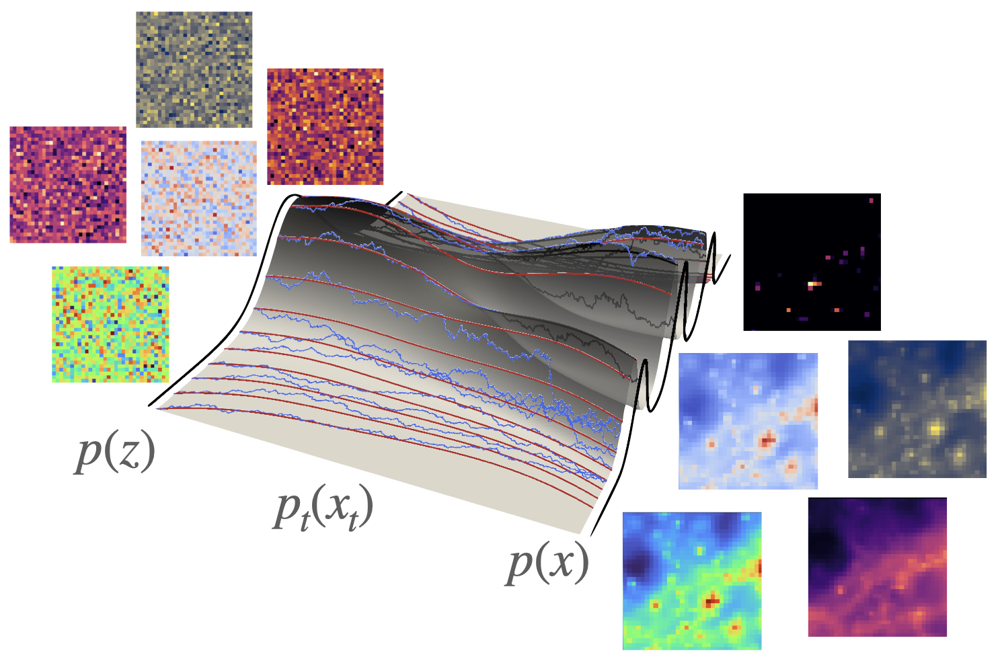

<h1 align='center'> joint </h1>
<h2 align='center'> Code for simple multi-modal generative models </h2>

Basic code to implement a multi-modal generative model. A DiT model is wrapped in encoder-decoder modules for each modality, which are trained end to end.

    
    <em>A diagram of a multi-modal flow matching model that was built with this code, mapping multi-modal output from a cosmological N-body simulation.</em>

